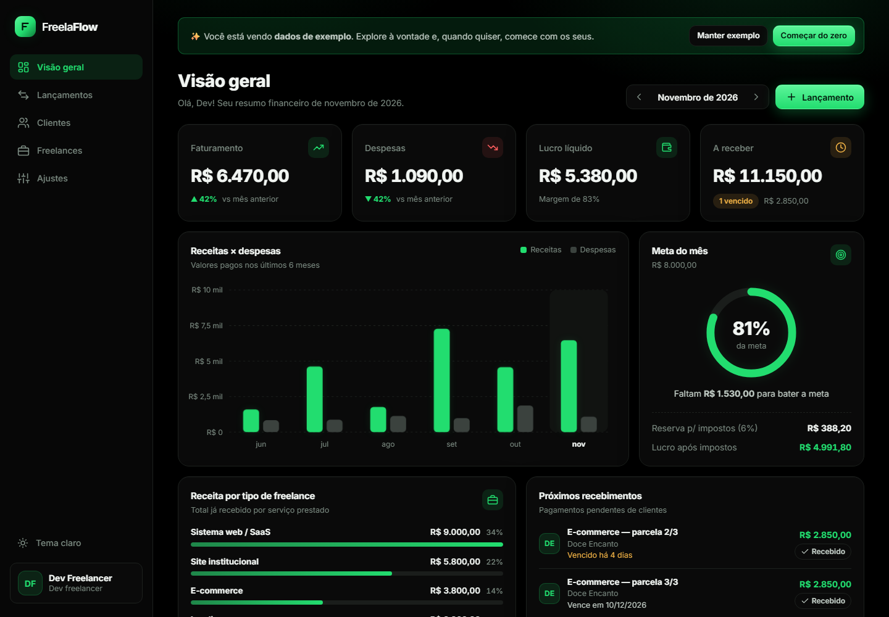

# FreelaFlow 💸

**Controle financeiro feito para desenvolvedores freelancers.**
Receitas, despesas, clientes, projetos e metas, tudo em um painel só. Sem cadastro, sem servidor, sem dependências.

> 🔗 **Acesse:** **[pedrorochafernandes.github.io/freelaflow](https://pedrorochafernandes.github.io/freelaflow/)**: abre com dados de exemplo, sem cadastro.



---

## ✨ Funcionalidades

| Tela | O que faz |
|---|---|
| **Visão geral** | KPIs do mês (faturamento, despesas, lucro e valores a receber) com comparação ao mês anterior, gráfico de receitas × despesas dos últimos 6 meses, meta mensal com anel de progresso, reserva para impostos, **receita por tipo de freelance**, despesas por categoria, próximos recebimentos e ranking de clientes |
| **Lançamentos** | Cadastro de receitas e despesas com **seleção do freelance realizado** (preenche cliente, categoria e descrição sozinho), status (pago/pendente/vencido), filtros por mês, status e freelance, busca e exportação para CSV (abre direto no Excel) |
| **Clientes** | Cartões com contato, total faturado, valor a receber e número de freelances |
| **Freelances** | Kanban (Proposta → Em andamento → Concluído) com tipo de serviço (landing page, e-commerce, SaaS…), barra de quanto já foi recebido, alerta de prazo e atalho para registrar pagamento |
| **Ajustes** | Meta mensal, alíquota de imposto, tema claro/escuro, backup/restauração em JSON |

**Extras:** visual preto e verde (com opção de tema claro), layout responsivo (no celular a navegação vai para a barra inferior), atalho <kbd>N</kbd> para novo lançamento, dados de exemplo gerados a partir da data atual, acessível por teclado e respeitando `prefers-reduced-motion`.

## 🛠️ Tecnologias

- **HTML, CSS e JavaScript puros**, sem frameworks e sem etapa de build
- **Gráficos em SVG feitos à mão** (barras, rosca e anel), sem Chart.js nem bibliotecas externas
- **CSS moderno**: design tokens em custom properties (paleta preto + verde), `color-mix()`, grid, `<dialog>` nativo
- **localStorage** para persistência: os dados nunca saem do navegador do usuário
- `Intl.NumberFormat` / `toLocaleDateString` para moeda e datas em pt-BR

## 📁 Estrutura

```
freelaflow/
├── index.html        # casca da aplicação (sidebar, topbar, modal)
├── css/styles.css    # design tokens, componentes e responsividade
└── js/
    ├── utils.js      # formatação, datas, ícones SVG
    ├── store.js      # estado, persistência, consultas e dados de exemplo
    ├── charts.js     # gráficos SVG (barras, rosca, anel)
    └── app.js        # views, formulários e eventos
```

A arquitetura segue um fluxo simples e previsível: **Store → render → eventos delegados → Store**.
Cada alteração passa pelo `Store`, que salva no `localStorage` e avisa os assinantes para redesenhar a tela.

## 🚀 Como rodar

Não precisa instalar nada. Basta abrir o `index.html` no navegador.

Se preferir um servidor local:

```bash
python -m http.server 5173
```

E acesse `http://localhost:5173`.

## 🌐 Deploy no GitHub Pages

1. Crie um repositório `freelaflow` e envie os arquivos
2. Em **Settings → Pages**, selecione a branch `main` e a pasta `/ (root)`
3. Em ~1 minuto o app estará em `https://<seu-usuario>.github.io/freelaflow`

(Também funciona arrastando a pasta no [Netlify Drop](https://app.netlify.com/drop) ou com `vercel` na pasta.)

## 🗺️ Próximos passos

- [ ] Lançamentos recorrentes automáticos (assinaturas, manutenção mensal)
- [ ] Geração de recibo/orçamento em PDF
- [ ] Sincronização na nuvem (Supabase/Firebase) com login
- [ ] PWA instalável e funcionando offline

---

Feito por **Pedro Rocha** ([@PedroRochaFernandes](https://github.com/PedroRochaFernandes)). Se curtir, deixa uma ⭐!
