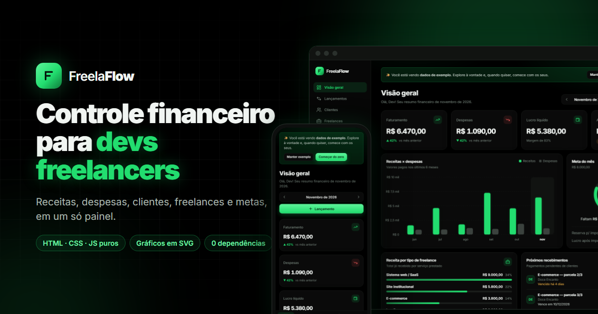
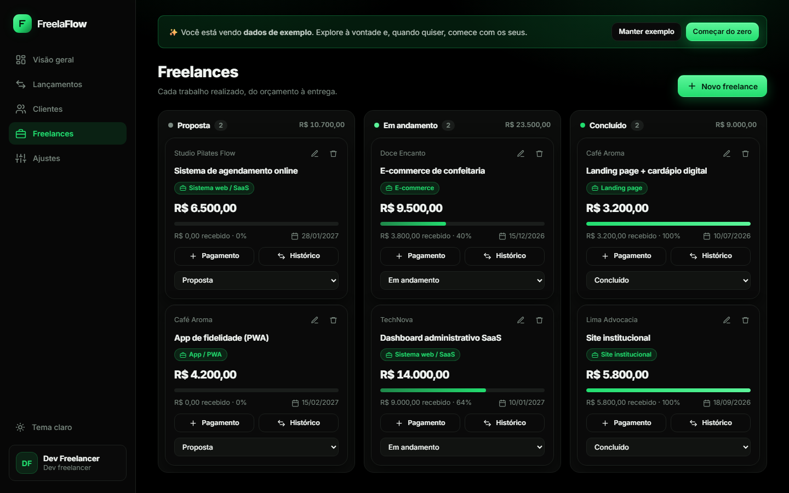
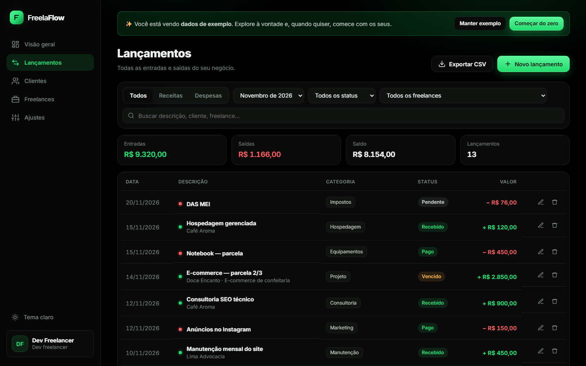
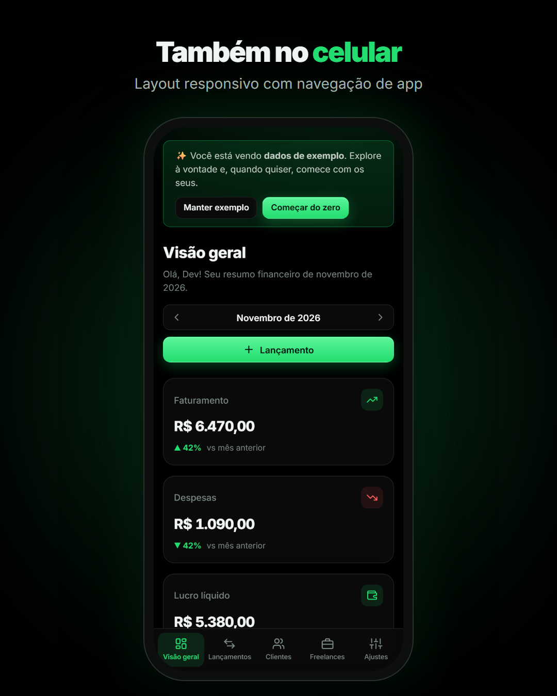
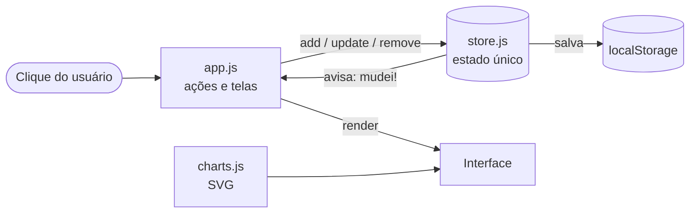

<div align="center">



# FreelaFlow

**Controle financeiro feito para desenvolvedores freelancers.**
Receitas, despesas, clientes, freelances e metas em um só painel.

[](https://pedrorochafernandes.github.io/freelaflow/)
&nbsp;
[](https://github.com/PedroRochaFernandes/freelaflow/releases)


_Abre direto com dados de exemplo. Sem cadastro, sem instalar nada._

</div>

---

## 💡 Por que eu criei

Como dev freelancer, eu vivia a mesma confusão todo mês: o dinheiro entrava, mas eu não sabia direito **quanto era lucro**, **quanto precisava guardar para o imposto** e **qual cliente ainda estava me devendo**.

Planilha resolvia pela metade. Então construí a ferramenta que eu queria usar, e aproveitei para me desafiar: **nenhum framework, nenhuma biblioteca**. Só os fundamentos da web.

## ✨ O que ele faz

| | |
|---|---|
| 📊 **Dashboard do mês** | Faturamento, despesas, lucro e margem, comparados com o mês anterior |
| 🎯 **Meta + impostos** | Meta mensal com anel de progresso e reserva automática para impostos |
| 🧩 **Freelance realizado** | Ao lançar um pagamento, você escolhe o trabalho e o app preenche cliente, categoria e descrição |
| 📋 **Kanban de freelances** | Proposta → Em andamento → Concluído, com tipo de serviço, % já recebido e alerta de prazo |
| 💼 **Receita por tipo de serviço** | Descubra se landing pages, e-commerces ou sistemas SaaS dão mais retorno |
| ⏰ **Contas a receber** | Pagamentos pendentes e vencidos, com botão "Recebido" |
| 👥 **Clientes** | Total faturado, valor em aberto e número de freelances de cada um |
| 📁 **Seus dados, sob seu controle** | Tudo fica no seu navegador. Exporta CSV (abre no Excel) e backup em JSON |

## 📸 Telas

| Freelances | Lançamentos |
|---|---|
|  |  |

<p align="center"></p>

## 🛠️ Destaques técnicos

- **Zero dependências:** HTML, CSS e JavaScript puros, sem build. Abre com dois cliques no `index.html`
- **Gráficos em SVG feitos à mão:** barras, rosca e anel de progresso, calculados com regra de três e `stroke-dasharray` (sem Chart.js)
- **Estado centralizado + padrão Observer:** toda alteração passa por um `Store`, que salva e avisa a interface para se redesenhar
- **Renderização declarativa:** cada tela é uma função que transforma dados em HTML, no mesmo espírito dos componentes do React
- **Delegação de eventos:** um único listener atende o app inteiro via `data-action`
- **Formulários guiados por configuração:** um único `openForm({ fields })` gera todos os formulários
- **Segurança:** todo texto do usuário é escapado antes de ir para a tela (prevenção de XSS)
- **Design system com tokens CSS:** tema preto e verde e tema claro trocados por um único atributo
- **Responsivo e acessível:** navegação inferior no celular, tabela que vira cartões, `<dialog>` nativo, foco visível e `prefers-reduced-motion`

### Arquitetura



```
freelaflow/
├── index.html        # estrutura da aplicação
├── css/styles.css    # design tokens, componentes e responsividade
└── js/
    ├── utils.js      # moeda, datas, ícones e segurança (escape de HTML)
    ├── store.js      # estado, persistência, cálculos e dados de exemplo
    ├── charts.js     # gráficos em SVG
    └── app.js        # telas, formulários e eventos
```

## 🚀 Como rodar

Não precisa instalar nada: baixe o projeto e abra o `index.html` no navegador.

```bash
git clone https://github.com/PedroRochaFernandes/freelaflow.git
```

Se preferir um servidor local, rode este comando dentro da pasta e acesse `http://localhost:5173`:

```bash
python -m http.server 5173
```

## 🧠 O que eu aprendi

- Como frameworks funcionam por baixo: estado, re-renderização e eventos, implementados do zero
- Que `new Date('2026-11-16')` é interpretado em UTC e pode virar o dia anterior no Brasil
- Desenhar visualização de dados com SVG puro e deixá-la responsiva com `viewBox`
- Montar um design system pequeno, mas consistente, só com variáveis CSS

## 🗺️ Próximos passos

- [ ] Lançamentos recorrentes automáticos (assinaturas, manutenção mensal)
- [ ] Recibos e orçamentos em PDF
- [ ] Sincronização na nuvem com login
- [ ] PWA instalável, funcionando offline

Sugestões e feedbacks são muito bem-vindos: abra uma [issue](https://github.com/PedroRochaFernandes/freelaflow/issues)!

---

<div align="center">

Feito por **Pedro Rocha** · [GitHub](https://github.com/PedroRochaFernandes)

Se o projeto te ajudou ou te inspirou, deixa uma ⭐

</div>
